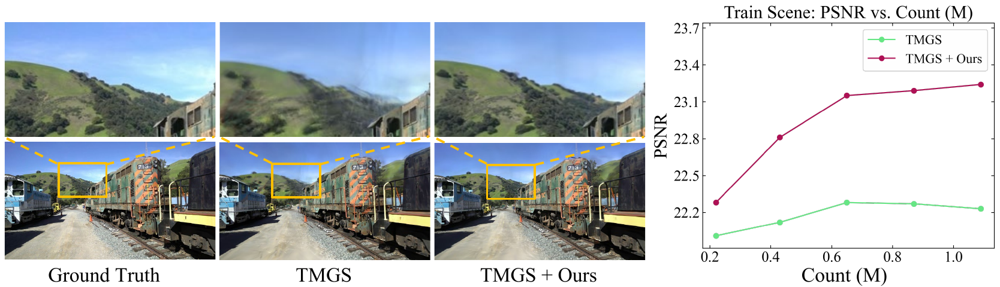
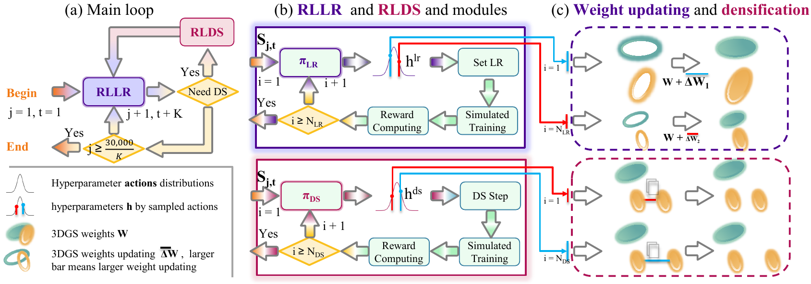

# RLGS: Reinforcement Learning-Based Adaptive Hyperparameter Tuning for Gaussian Splatting

## WACV 2027

[Project Page](https://rlgs-share-ad5bebf9f9504206.lizhan416824.chatgpt.site/) | [Paper](https://arxiv.org/abs/2508.04078) | [Pretrained Models](https://huggingface.co/stack93/RLGS_models/tree/main)

This is the official repository for the paper **"RLGS: Reinforcement Learning-Based Adaptive Hyperparameter Tuning for Gaussian Splatting"**.<br>
[Zhan Li](https://lizhan17.github.io/web/),
[Huangying Zhan](https://huangying-zhan.github.io/),
[Changyang Li](https://changyangli.github.io/),
[Qingan Yan](https://yanqingan.github.io/),
[Yi Xu](https://www.linkedin.com/in/yi-xu-42654823)<br>
Goertek Alpha Labs



*RLGS improves Taming-3DGS across Gaussian budgets on the Train scene, including budgets where the baseline's reconstruction quality saturates.*

## Updates and News

- `Aug 6, 2025`: Our [arXiv paper](https://arxiv.org/abs/2508.04078) is released.
- `Oct 14, 2026`: Our paper has been accepted to WACV 2027. Thank you to all authors, reviewers, area chairs, and the 3DGS community.
- More frameworks including LichtFeld Studio (WIP) coming soon.

## Table of Contents

1. [Overview](#overview)
2. [Implementations](#implementations)
3. [Installation and Reproduction](#installation-and-reproduction)
4. [License Information](#license-information)
5. [Acknowledgements](#acknowledgements)
6. [Citation](#citation)

## Overview

**RLGS learns to adjust Gaussian Splatting hyperparameters during reconstruction.** Lightweight policies evaluate candidate settings through short simulated training runs and use reconstruction rewards to guide subsequent updates.

- **RLLR** adapts learning rates throughout training.
- **RLDS** adapts densification hyperparameters where the backbone supports them.



## Implementations

RLGS is adapted to each backbone's training procedure and hyperparameters. The implementations use separate training code and method-specific dependencies.

| Implementation | Backbone |
| --- | --- |
| [`rl_tmgs`](rl_tmgs/README.md) | Taming-3DGS |
| [`rl_asymgs`](rl_asymgs/README.md) | AsymGS-EMA |
| [`rl_mcmc`](rl_mcmc/README.md) | 3DGS-MCMC |

The three released implementations each have their own setup and validation instructions.

The repository is organized as follows:

```text
rlgs/
├── README.md
├── docs/images/
├── rl_tmgs/
├── rl_asymgs/
└── rl_mcmc/
```

## Installation and Reproduction

RL-TMGS installation and one-command Train/Truck reproduction are documented in [rl_tmgs/README.md](rl_tmgs/README.md). For RL-AsymGS and RL-MCMC, start with the method README and `SETUP_AND_TEST.md` in the corresponding directory.

### Installation

Each implementation requires its matching PyTorch, CUDA and rasterizer dependencies. The methods use separate environments with their respective rasterizers.

Method-specific environment manifests and setup scripts are included. CUDA smoke tests and checkpoint evaluation were completed in compatible existing environments; fresh dependency downloads for all methods have not yet been verified end to end.

### Dataset Preparation

| Implementation | Datasets |
| --- | --- |
| RL-TMGS | Tanks and Temples, Deep Blending, DL3DV-140 |
| RL-AsymGS | RobustNeRF: Yoda, Crab, Statue, Android |
| RL-MCMC | Mip-NeRF 360: the paper's seven-scene protocol |

The RL-TMGS reproduction command downloads and verifies the official Train/Truck data when needed. The remaining method READMEs document their expected datasets, layouts and evaluation entry points.

### Training and Testing

RL-TMGS provides `reproduce_tnt.sh` to train, render and evaluate the frozen Train/Truck recipe. RL-MCMC provides path-based `train.sh` and `evaluate.sh` wrappers around its released trainer and native render/metrics evaluation. RL-AsymGS and RL-MCMC also provide `setup.sh`, `test.sh` and `SETUP_AND_TEST.md` for environment and CUDA smoke tests.

## License Information

Each implementation includes its applicable license and upstream attribution. Upstream code, assets and dependencies retain their respective licenses and notices; consult the files included with each method before use.

## Acknowledgements

Our implementations build on the following projects. We thank the authors for their work and released code:

- [3D Gaussian Splatting](https://github.com/graphdeco-inria/gaussian-splatting)
- [Taming-3DGS](https://github.com/humansensinglab/taming-3dgs)
- [AsymGS](https://github.com/steveli88/AsymGS)
- [3DGS-MCMC](https://github.com/ubc-vision/3dgs-mcmc)

Please also cite the backbone relevant to your experiments.

## Citation

If you find this work useful, please consider citing:

```bibtex
@misc{li2025rlgs,
  title         = {RLGS: Reinforcement Learning-Based Adaptive Hyperparameter Tuning for Gaussian Splatting},
  author        = {Zhan Li and Huangying Zhan and Changyang Li and Qingan Yan and Yi Xu},
  year          = {2025},
  eprint        = {2508.04078},
  archivePrefix = {arXiv},
  primaryClass  = {cs.GR},
  url           = {https://arxiv.org/abs/2508.04078}
}
```
